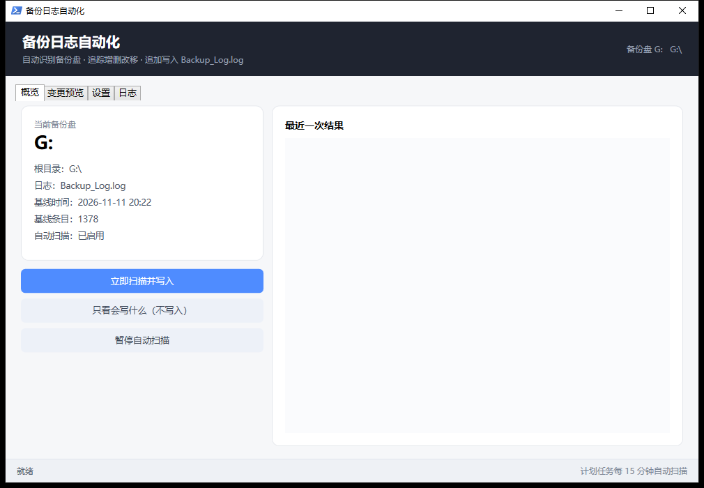

# Backup Log 自动化

> 把「手动记录备份盘变动」变成「自动扫描 + 自动补日志」。
>
> Auto-generate a human-readable change log for any backup drive: it snapshots the drive,
> diffs it against the previous run, and appends `UPLOAD / UPDATE / DELETE / RENAME / MOVE / ARCHIVE`
> entries to a plain-text log — in exactly the format the log already uses.

一个 Windows 小工具：给备份盘（移动硬盘、网盘挂载盘都行）自动记账。

你照常往盘里拖文件、改名、删除，它定时扫描、比对快照，把变化按固定格式追加到盘根的
`Backup_Log.log` 里。**换电脑、换盘符都不用改配置**——靠盘根的特征文件识别，不写死 `G:`。

[](LICENSE)
[](#)
[](#)
[](https://github.com/Yamanaka-Ame/backup-log-automatic/actions/workflows/test.yml)


---

## 它解决什么问题

如果你有「定期把重要东西备份到一块盘」的习惯，通常会顺手记一份日志：哪天传了什么、删了什么、
把哪个文件夹改名了。这份日志看的时候很有用，但手写很烦，而且一忙就断更。

这个工具把「记账」这件事自动化了：

- 你只管往盘里放东西，日志自动长出来
- 历史日志原样保留，只在后面追加，不会重写
- 不依赖任何云服务，纯本地，日志就是一个文本文件

## 特性

- **自动识别备份盘**：扫描所有盘，盘根有 `Backup_Log.log` 的那块就是（可加目录名做更严格的限定）
- **追踪全部动向**：新建目录、新增文件、修改、删除、目录改名/搬家、文件改名/移动、打包归档
- **改名不误报**：目录改名靠子树内容指纹匹配，不会写成「删了 30 个文件 + 传了 30 个文件」
- **归档识别**：目录消失、同目录冒出压缩包且体积对得上，记成 `ARCHIVE` 而不是删除
- **图片合并**：同目录同批图片超过阈值时合并成一条 `UPLOAD 12 image(s) TO "..."`，日志不至于被刷屏
- **安全阀**：首次静默建基线、单次变化超阈值中止、写前自动备份日志、并发锁、试运行模式
- **两种用法**：WPF 图形界面 + 命令行，共用同一套核心逻辑

## 快速开始

需要 Windows 10/11 自带的 PowerShell 5.1，不需要装任何东西。

### 三步开始

| ① | ② | ③ |
|:--:|:--:|:--:|
| **下载 ZIP**<br>Code → Download ZIP | **解压到任意目录**<br>别放需要管理员权限的位置 | **双击 `setup.cmd`**<br>按提示选盘 |

向导会自动解除脚本的「来自网络」锁定，没有日志就创建一个，然后写配置、建基线，
并询问是否安装计划任务和桌面快捷方式。

### 或者手动跑命令

```powershell
# 1. 看看认没认出备份盘（只读，不写任何东西）
powershell -NoProfile -ExecutionPolicy Bypass -File .\backup-log.ps1 -Action detect

# 2. 建立基线（必须跑一次；不写日志，只记录「当前长什么样」）
powershell -NoProfile -ExecutionPolicy Bypass -File .\backup-log.ps1 -Action init

# 3. 看看会写什么（不写入）
powershell -NoProfile -ExecutionPolicy Bypass -File .\backup-log.ps1 -Action scan -DryRun

# 4. 真正写入
powershell -NoProfile -ExecutionPolicy Bypass -File .\backup-log.ps1 -Action scan

# 5. 装成计划任务，每 15 分钟自动跑
powershell -NoProfile -ExecutionPolicy Bypass -File .\tools\Install-Schedule.ps1 -IntervalMinutes 15
```

图形界面：双击 `gui\install.ps1` 装出来的快捷方式（或直接运行）

```powershell
powershell -NoProfile -STA -ExecutionPolicy Bypass -File .\gui\BackupLog.Gui.ps1
```

## 盘符识别

依次检查所有固定盘、移动盘、网络盘，盘根满足条件的才算备份盘。默认条件只有一个：

- 盘根存在 `Backup_Log.log`

想在多块盘之间避免误认，在 `config.json` 的 `requiredMarkers` 里加上你自己的特征目录：

```json
"requiredMarkers": ["Backup_Log.log", "我的备份"]
```

找到多块符合的盘时直接报错并要求用 `-Root` 指定，不会瞎猜。

## 日志格式

UTF-8 无 BOM、CRLF、`[yyyy-MM-dd HH:mm]` 时间块、块间一个空行：

```
[2026-11-11 22:08]
CREATE FOLDER "网站备份" AT ":\重要资料\"
UPLOAD "site-2026-11-08.zip" TO ":\重要资料\网站备份\"
UPDATE "config-backup.dat" TO ":\重要资料\网站备份\"
RENAME FOLDER ":\重要资料\旧名字\" TO ":\重要资料\新名字\"
MOVE "photo.jpg" TO ":\重要资料\图片\"
DELETE ":\重要资料\临时\"
ARCHIVE ":\重要资料\图片\相册\" TO ARC-202611112245.zip
```

| 盘上实际发生 | 写进日志的条目 |
| --- | --- |
| 目录从无到有 | `CREATE FOLDER "名字" AT "父目录\"`，父目录在前 |
| 文件从无到有 | `UPLOAD "文件名" TO "目标目录\"` |
| 同名文件大小或时间变了 | `UPDATE "文件名" TO "目录\"` |
| 目录消失 + 同目录出现压缩包（体积 15%~135%） | `ARCHIVE "目录\" TO 包名.zip` |
| 目录消失 | 只写一条 `DELETE "目录\"`，不再罗列里面的文件 |
| 目录改名/搬家（内容指纹一致） | `RENAME FOLDER "旧\" TO "新\"`，子树不再重复记录 |
| 文件改名 | 同目录 `RENAME "旧" TO "新"`；跨目录 `MOVE "文件名" TO "新目录\"` |
| 同目录同批图片 ≥ 阈值 | `UPLOAD 12 image(s) TO "目录\"`，其它类型仍逐条记录 |

同一分钟内多次扫描会并入同一个时间块，不会刷出一堆碎块。

## 静默运行

计划任务通过 `wscript.exe //B tools\RunScan.vbs` 启动，由 VBS 以隐藏窗口拉起 PowerShell ——
全程没有控制台窗口，每 15 分钟跑一次也看不到任何闪烁。


## 安全设计

- **首次静默**：没有状态文件时只建基线，不会把盘上现有几千个文件当成「新增」灌进日志
- **阈值保护**：一次变化超过基线的 40%（且少于 20 项时不拦）默认中止，防止认错盘或同步软件整盘重刷
- **写前备份**：每次追加前把日志复制到 `<盘>\.backup-log\backups\`，保留最近 10 份
- **并发锁**：同时只允许一个扫描写日志；锁里记 PID，进程没了会自动接管
- **真试运行**：`-DryRun` 只打印将要追加的内容，不写日志也不更新状态
- **状态跟着盘走**：`<盘>\.backup-log\state.json`，换电脑也能接着算
- **暂停标记**：存在 `paused` 标记时扫描直接跳过

## 图形界面

四个页签：概览 / 变更预览 / 设置 / 日志。

- 概览：当前备份盘、根目录、基线时间、条目数、自动扫描状态；立即扫描 / 只看会写什么 / 一键停用或启用自动扫描
- 变更预览：表格列出「动作 + 对象」，可以先看再决定是否写入
- 设置：扫描间隔、路径写法、变化阈值、归档识别、图片合并阈值、开机自启
- 日志：最近 12 个时间块，可一键用记事本打开完整日志

界面的「停用自动扫描」会真正禁用计划任务（`schtasks /Change /DISABLE`），任务不再唤醒、不会有任何开销；点「启用」再恢复。
如果当前环境没有权限操作计划任务，会退回写 `paused` 标记文件的降级方案。

## 配置

`config.json`：

| 键 | 说明 |
| --- | --- |
| `requiredMarkers` | 认出备份盘需要的标记，默认 `["Backup_Log.log"]` |
| `logFile` | 日志文件名，默认 `Backup_Log.log` |
| `stateDir` | 状态目录，默认 `.backup-log`（可写绝对路径） |
| `excludeTop` | 整目录跳过的顶层项 |
| `excludeExact` | 精确跳过的相对路径（日志自身必须排除，否则每写一次就触发自己） |
| `pathStyle` | `relative` 写 `:\目录\...`；`drive` 写 `G:\目录\...` |
| `maxChangePercent` | 阈值保护的百分比，默认 40 |
| `detectArchive` | 是否识别「打包归档」，默认开 |
| `aggregateImages` | 同目录同批图片合并阈值，默认 10；`0` 关闭 |
| `scanIntervalMinutes` | 计划任务扫描间隔 |

## 已知限制

- 改名靠「同大小 + 同修改时间」的内容指纹；改名同时改内容会退化成 `DELETE + UPLOAD`
- 内容变了但大小和时间戳都没变（某些同步客户端会保留时间戳）检测不到
- 文件夹只记录创建、删除、改名，单独修改文件夹时间不写日志（否则全是噪音）
- 云盘客户端重新下载导致 mtime 变化时会出现 `UPDATE`，属预期

## 文件

```
backup-log.ps1             CLI：detect / init / scan / status / watch / pause / resume / unlock
lib\BackupLog.Core.ps1     核心：识别、快照、对比、格式化、写入
config.json                配置
gui\BackupLog.Gui.ps1      WPF 界面
gui\install.ps1            快捷方式 / 开机自启
gui\build-exe.ps1          可选：编译单文件 exe（系统自带 csc，无需 SDK）
tools\Setup.ps1           首次使用向导（选盘 / 建日志 / 建基线 / 装任务）
setup.cmd                 双击入口，调用上面的向导
tools\Install-Schedule.ps1 计划任务安装 / 卸载 / 查看
tests\Run-Tests.ps1        假盘上的 31 项自动化测试
tools\Normalize-Log.ps1   把历史日志条目统一成本工具的输出格式（只改写法，不动时间块）
docs\screenshot.png        界面截图
```

## 测试

```powershell
powershell -NoProfile -ExecutionPolicy Bypass -File .\tests\Run-Tests.ps1
```

在临时目录里造一块假盘，跑完整流程：新建 / 修改 / 删除 / 改名 / 移动 / 归档 / 图片合并 /
幂等性 / 格式（CRLF、无 BOM、块间空行）/ 阈值保护。当前 31 项全过，不接触真实数据。

## 更新日志

见 [CHANGELOG.md](CHANGELOG.md)。

## License

MIT
